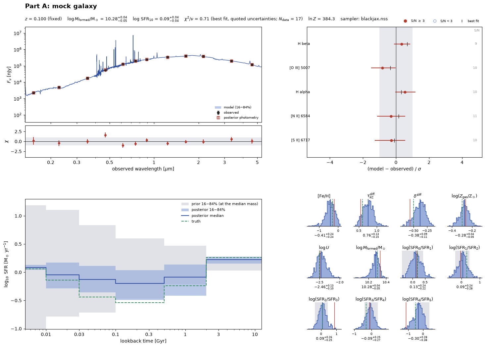

# Running Ceridwen on the Elkhorn DGX nodes

Set up a Python environment on a DGX node and run the example fit, from an empty home directory to a finished plot.

| | |
|---|---|
| **Hardware** | 224 cores, 8 B200 GPUs |
| **Software** | Python 3.14, CUDA 13.1 |
| **Output** | One summary figure (`test.png`) |
| **Example script** | [`ceridwen_build_your_own.py`](ceridwen_build_your_own.py) |

## Contents

1. [Request a DGX node](#1-request-a-dgx-node)
2. [Configure your software environment](#2-configure-your-software-environment)
3. [Create and activate a virtual environment](#3-create-and-activate-a-virtual-environment)
4. [Set `$SPS_HOME`](#4-set-sps_home)
5. [Install Ceridwen](#5-install-ceridwen)
6. [Make a run directory](#6-make-a-run-directory)
7. [Run the example](#7-run-the-example)

> [!IMPORTANT]
> Do every step after the first one while logged in to the DGX node.

## 1. Request a DGX node

Ask Slurm for a whole node:

```bash
srun --nodes 1 --ntasks=224 --exclusive --partition=dgx-gpu --account=g-compastro --qos=g-compastro --gres=gpu:8 --pty bash -i
```

## 2. Configure your software environment

Write the module setup to a file so you can reload it with one command:

```bash
mkdir ~/config
echo "module purge; module load ohpc python/3.14.10 gnu14/14.2.0 cuda/13.1.1 hdf5/1.14.6 git" > ~/config/configure-dgx-gpu.sh
source ~/config/configure-dgx-gpu.sh
```

> [!NOTE]
> Source this file every time you start working on a DGX node.

To check that it worked, list the loaded modules:

```bash
module list
```

You should see:

```text
Currently Loaded Modules:
  1) ohpc   2) python/3.14.10   3) gnu14/14.2.0   4) cuda/13.1.1   5) hdf5/1.14.6   6) git/2.52.0
```

## 3. Create and activate a virtual environment

This creates the environment in your home directory:

```bash
cd
python3 -m venv dgx-gpu-env
source dgx-gpu-env/bin/activate
```

## 4. Set `$SPS_HOME`

The FSPS git repository is already at `/groups/comp-astro/fsps`, and you can use it as `$SPS_HOME`. These commands add it to your `~/.bashrc`, so it loads automatically in future sessions:

```bash
echo export SPS_HOME="/groups/comp-astro/fsps" >> ~/.bashrc
source ~/.bashrc
```

> [!NOTE]
> You only need to run this once. After the first time, skip the `source`.

## 5. Install Ceridwen

```bash
python3 -m pip install "ceridwen[cuda13]"
```

## 6. Make a run directory

Replace `<username>` with your own username:

```bash
cd /groups/comp-astro/<username>
mkdir ceridwen
cd ceridwen
```

## 7. Run the example

Copy [`ceridwen_build_your_own.py`](ceridwen_build_your_own.py) into this directory (adapted from Amanda's tutorial), then run it:

```bash
python3 ceridwen_build_your_own.py
```

The script writes `test.png`. It should look like this:



*Expected output: the fitted SED and residuals (top left), emission-line residuals (top right), the recovered star formation history against the truth (bottom left), and the parameter posteriors (bottom right).*

## Questions or problems?

Ask in the group Slack channel.
